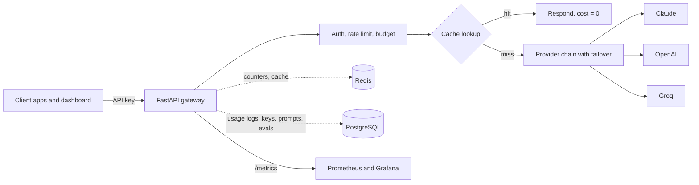
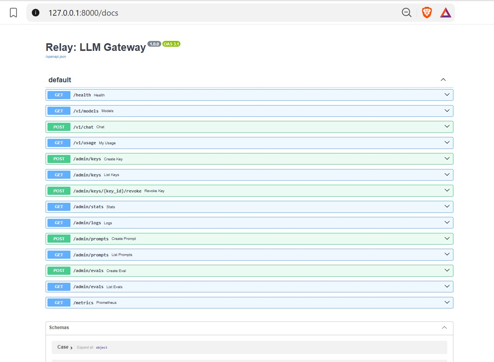

# Relay: LLM Gateway

A production-style gateway that sits between your apps and LLM providers (Claude, OpenAI, Groq). One API in, many providers out, with the controls teams need once LLMs go to production.

| Capability | How it works |
|---|---|
| Unified API | `POST /v1/chat` works the same for every provider. Streaming (SSE) and non-streaming |
| Failover | Ordered fallback chain per request, plus a circuit breaker that skips a model after repeated failures |
| Caching | Exact-match cache and a similarity cache (typos, small rewordings) in Redis or memory. Safe by design: different numbers never match |
| Auth and limits | Hashed API keys, per-key rate limit (requests per minute), optional monthly budget (HTTP 402) |
| Cost tracking | Tokens and USD per request, per key, per model. Savings from the cache are tracked too |
| Prompt versioning | Save prompts as `name@vN`, then call them by reference with variables |
| Eval harness | Run a test set against two prompt/model variants and compare score, latency, and cost |
| Observability | Prometheus `/metrics`, Grafana-ready, usage log in PostgreSQL |
| Dashboard | Playground, overview, key management, evals (static page, deploys on Vercel) |

**It works with zero provider keys.** Built-in mock models (`mock-fast`, `mock-smart`, `mock-flaky`) let you demo caching, failover, and evals offline. Add a real key and the real models appear automatically.

## Architecture



## Run locally (VS Code, Windows)

```powershell
python -m venv .venv
.venv\Scripts\activate
pip install -r requirements-dev.txt
python -m uvicorn src.main:app --reload            # API and docs at http://localhost:8000/docs
```

Second terminal, for the dashboard:

```powershell
python -m http.server 5500 --directory frontend     # open http://localhost:5500
```

Locally the gateway uses SQLite and an in-memory cache, so there is nothing else to install. In the dashboard click **Playground → Get a demo key**, then **Send**. The admin key defaults to `your-local-development-secret`.

Run the tests: `pytest -q`

### Use real models

Set any of these before starting the server (PowerShell example):

```powershell
$env:ANTHROPIC_API_KEY="sk-ant-..."; $env:GROQ_API_KEY="gsk_..."; $env:OPENAI_API_KEY="sk-..."
python -m uvicorn src.main:app --reload
```

Model names and prices live in `src/pricing.py`. The prices are approximate, so check each provider's pricing page.

## API quick tour

```bash
# create a key (admin)
curl -X POST localhost:8000/admin/keys -H "X-Admin-Key: your-local-development-secret" -H "Content-Type: application/json" \
     -d '{"name":"my-app","rate_limit_per_min":60,"monthly_budget_usd":5}'

# chat (use the key from above)
curl -X POST localhost:8000/v1/chat -H "Authorization: Bearer gw_..." -H "Content-Type: application/json" \
     -d '{"model":"auto","messages":[{"role":"user","content":"What is the capital of France?"}]}'
```

Response fields: `content`, `provider`, `model`, `cached` (`none`, `exact`, `semantic`), `input_tokens`, `output_tokens`, `cost_usd`, `saved_usd`, `latency_ms`, `fallback_used`, `attempts`.

| Endpoint | Purpose |
|---|---|
| `POST /v1/chat` | Chat completion. Set `"stream": true` for SSE, `"fallbacks": [...]` for a custom chain, `"use_cache": false` to bypass the cache |
| `GET /v1/models` | Models currently available, with prices |
| `GET /v1/usage` | Usage and spend for the calling key |
| `POST /admin/keys`, `GET /admin/keys`, `POST /admin/keys/{id}/revoke` | Key management |
| `GET /admin/stats`, `GET /admin/logs` | Cache hit rate, spend, savings, latency percentiles, request log |
| `POST /admin/prompts`, `GET /admin/prompts` | Versioned prompt library |
| `POST /admin/evals`, `GET /admin/evals` | Run and list evaluations |
| `GET /metrics`, `GET /health` | Prometheus metrics, liveness |

Calling a saved prompt: `{"model":"auto","prompt":{"name":"qa","version":2,"variables":{"q":"..."}}}`. Leave out `version` for the latest.

## Run everything with Docker

```bash
docker compose up --build
```

API on :8000, PostgreSQL, Redis, Prometheus on :9090, Grafana on :3000 (login admin/admin, add a Prometheus data source at `http://prometheus:9090`).

## Deploy

**Why not everything on Vercel?** The gateway is a long-running server with caches, circuit-breaker state, and streaming connections. Vercel's serverless functions are short-lived and stateless. Put the **API on Render** and the **frontend on Vercel**.

**1. Backend on Render (free tier)**
1. Push this repo to GitHub.
2. Render → New → **PostgreSQL** (free). Copy the *Internal Database URL*.
3. Render → New → **Key Value** (Redis, free). Copy its *Internal URL*. Optional: without it the gateway uses an in-memory cache, which is fine for one instance.
4. Render → New → **Web Service** → your repo → Runtime **Docker**.
5. Environment variables:
   - `DATABASE_URL` = the PostgreSQL URL
   - `REDIS_URL` = the Key Value URL (optional)
   - `ADMIN_KEY` = a long random string
   - `CORS_ORIGINS` = your Vercel URL (use `*` while testing)
   - `ANTHROPIC_API_KEY`, `OPENAI_API_KEY`, `GROQ_API_KEY` = any you have (all optional)
6. Health check path `/health`. Copy the service URL.

(`render.yaml` is an optional Blueprint that creates all three resources in one go: Render → New → Blueprint.)

**2. Frontend on Vercel**
1. Edit `frontend/config.js` and set `window.API_URL` to your Render URL. Commit and push.
2. Vercel → Add New Project → import the repo → **Root Directory: `frontend`**, Framework Preset **Other**, no build command.
3. Set `CORS_ORIGINS` on Render to your Vercel URL.
4. Open the site, enter your `ADMIN_KEY` in the sidebar, and create an API key.

Free-tier notes: Render sleeps when idle (the first request takes about 30 seconds), and its free PostgreSQL expires after 30 days.

## Load testing

```bash
python scripts/bench.py --key gw_... --requests 300 --concurrency 20     # no extra install
locust -f scripts/locustfile.py --host http://localhost:8000              # with a UI at :8089
```

Raise the key's rate limit (for example 100000/min) first. Run it against **your** deployment and record your own numbers:

| Scenario | Requests | Concurrency | p50 | p95 | Cache hit rate |
|---|---|---|---|---|---|
| Mock provider, 60% repeated prompts | | | | | |
| Real provider, 60% repeated prompts | | | | | |

The cost reduction for your resume is in **Overview → Saved by cache** (or `GET /admin/stats` → `savings_pct`) after a realistic run.

## Design decisions and limits

- **Failover only before the first token** when streaming. Once text has been sent to the client, the gateway cannot switch providers mid-answer.
- **Cache only when temperature is 0.3 or lower**, because creative sampling should not repeat.
- **The similarity cache** uses hashed character-trigram vectors: cheap, with no extra service, and good for typos and punctuation. It is not true semantic matching. To upgrade, replace `_vec()` in `src/semantic.py` with a real embedding model and a vector store. The similarity index lives in process memory, so with several replicas each builds its own (exact caching is shared through Redis).
- **Rate limiting** is a fixed window per minute. A sliding window or token bucket smooths bursts better.
- **Stats** are computed from the latest 5,000 log rows. At larger scale, use SQL aggregates or a metrics store.
- **Monthly budget** is checked against a spend figure cached for up to 10 seconds, so a burst can slightly overshoot.
- Admin access is a single shared key. For a team, add per-user accounts.

## Project structure

```
src/
  main.py        routes (chat, usage, admin, evals, metrics)
  gateway.py     cache, fallback chain, circuit breaker, cost
  providers.py   mock, OpenAI-compatible (OpenAI, Groq), Anthropic
  semantic.py    similarity cache index
  store.py       Redis or in-memory store
  security.py    API keys, rate limits, budgets, admin auth
  db.py          SQLAlchemy models (keys, usage logs, prompts, evals)
  evals.py       scoring and summaries
  metrics.py     Prometheus metrics
  pricing.py     model registry and prices
tests/           22 tests (API, cache, failover, limits, streaming, evals, provider adapters)
scripts/         bench.py, locustfile.py
frontend/        dashboard (deploy to Vercel)

## Security

- Admin endpoints require the `X-Admin-Key` header.
- Set the `ADMIN_KEY` environment variable before starting the application.
- If `ADMIN_KEY` is not configured, admin endpoints return HTTP 503.
- Requests with an incorrect admin key return HTTP 401.
- API keys are stored as hashes rather than plain text.

Never commit real API keys or admin secrets to the repository.

## Testing and Verification

The automated test suite covers API behavior, caching, provider failover, rate limits, streaming, and security.

Run the tests with:

```powershell
pytest -q
Latest test results:
- 22 tests passed
- 1 deprecation warning (Starlette/httpx TestClient)

### Manual Verification

The following features were manually tested:

- Health and model endpoints
- API key authentication
- Admin authentication
- Chat completion using the mock provider
- Provider fallback
- Exact response caching
- Streaming responses
- Usage and cost tracking
- Prometheus metrics
```
## Screenshots

### API Documentation



### Successful Chat Completion

**Request:**


**Response:**

 
